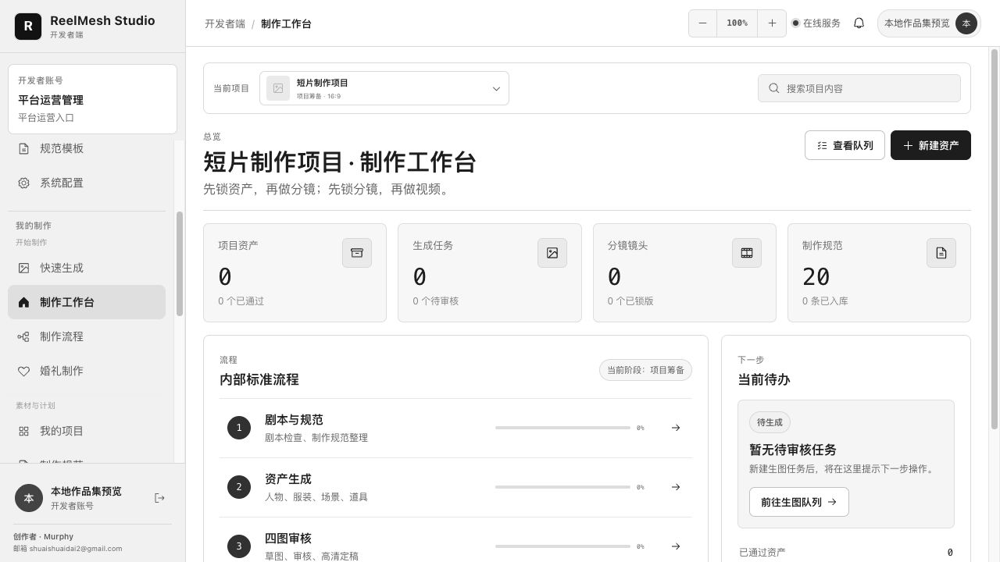
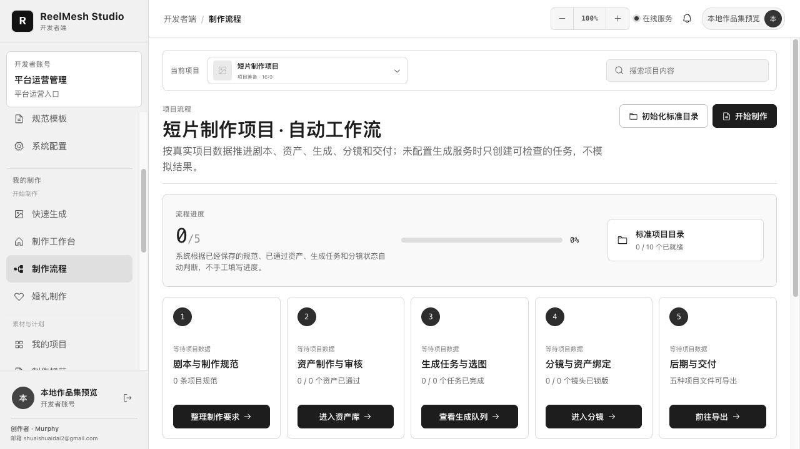
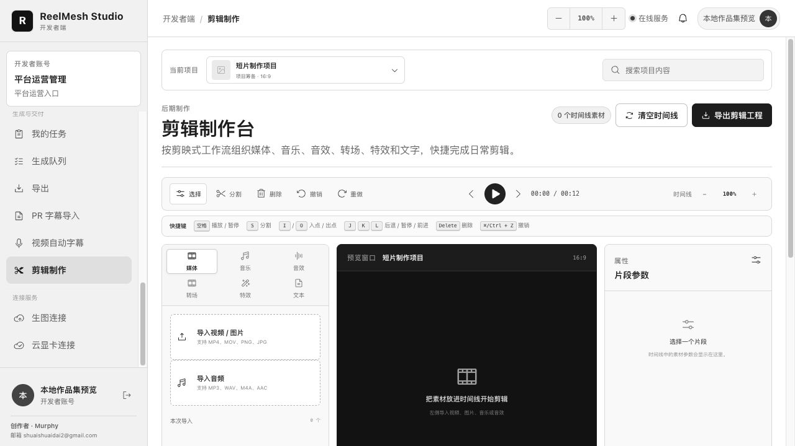

# ReelMesh Studio — Local-First AIGC Production Workbench

ReelMesh Studio is a local-first workspace for organizing AIGC-assisted film and video production. It brings project planning, production specifications, versioned assets, review, storyboards, generation jobs, subtitle processing, editing, and delivery into one desktop-oriented workflow.



**Author:** Dai Xudong (Murphy)  
**Stack:** React, Vite, Node.js, SQLite, Electron

## What It Does

- **Role-based workspaces:** Separate user, manager, administrator, and developer entry points with server-side role and data-scope checks.
- **Production planning:** Projects, reusable specifications, asset categories and versions, storyboard shots, assignments, reviews, and exports.
- **Image workflow:** Provider-adapter architecture, queued jobs, result review, retry, and approval. A real provider must be configured for real generation.
- **Subtitle delivery:** SRT import, Premiere style settings, batch rendering, and output-folder delivery. Local fonts and media tools are configured separately.
- **Editing workspace:** Multi-track timeline for video, music, sound effects, and text; transitions, effects, keyboard shortcuts, preview, and editable project export.
- **Local persistence:** Node.js API and SQLite database, with project files kept on the local machine in the desktop setup.

## Screenshots





## Architecture

```text
src/                       React role entry points and shared production workspace
server/                    Node.js API, SQLite schema, permissions, files, generation flows
public/music/ and public/sfx/  CC0 demo audio with source notices
electron-main.mjs          Desktop shell and loopback API startup
deploy/                    API container and cloud-video deployment references
scripts/                   Workflow and delivery verification
docs/                      Architecture, schema, deployment, and license notes
```

See the [architecture document](docs/ARCHITECTURE.md) and [diagram](screenshots/architecture.svg).

## Run Locally

Prerequisites: Node.js with `node:sqlite` support and npm.

```bash
npm ci
```

In one terminal, start the local API:

```bash
HJSC_LOCAL_ACCESS=1 npm run dev:api
```

In another terminal, start the web workspace:

```bash
npm run dev
```

Open the loopback URL printed by Vite. `HJSC_LOCAL_ACCESS=1` is for local development only; do not enable it on a public deployment.

The role pages (`user.html`, `manager.html`, `admin.html`, and `developer.html`) are Vite source entry points. Do not open them by double-clicking: `file://` cannot load their React modules or connect to the local API. After both services are running, use the Vite URL with the matching page path, for example `http://127.0.0.1:5173/user.html`. If Vite selects another port, use the URL it prints.

GitHub's file viewer displays source code; it does not run the app. GitHub Pages can serve static files, but it does not provide this project's Node.js API or SQLite runtime, so uploading the source alone does not create a working online service. The repository is intended to be run locally or packaged with Electron.

To launch the Electron desktop shell:

```bash
npm run desktop
```

## Verification

```bash
npm run build
npm run test:api
npm run test:image
npm run test:h3
npm run test:subtitle
```

## Scope and Current Limitations

This repository demonstrates a local-first application and its production workflows; it is not a hosted public service. There is no public online demo. Cloud image/video providers, model weights, local fonts, and media-processing binaries are not bundled and must be configured by the operator. The repository ships no client project data or runtime credentials.

The screenshots show the running interface. They are illustrative and do not represent generated production assets.

## Author Contributions

Dai Xudong (Murphy) designed and implemented the product workflow, React workspaces, Node.js API, SQLite data model, server-side permission checks, Electron integration, subtitle batch flow, and verification scripts. See [AUTHORS.md](AUTHORS.md).

## License and Third-Party Materials

The root MIT License applies only to first-party code and documentation. Original Skill/specification packages and client-provided fonts and Premiere styles are intentionally omitted because redistribution rights were not established. The included demo music and sound effects are listed with source links in their respective `NOTICE.md` files. Dependencies and other third-party materials retain their upstream licenses; see [THIRD_PARTY_NOTICES.md](docs/THIRD_PARTY_NOTICES.md).

## 中文简介

ReelMesh Studio 是一款面向影视制作的本地优先工作台，涵盖项目规划、制作规范、资产版本与审核、分镜、生图任务、字幕批处理、剪辑和交付。项目使用 React、Vite、Node.js、SQLite 与 Electron。

当前仓库是可本地运行的作品集源码，不提供在线 Demo；真实生图/视频服务、模型、字体和媒体处理工具需要另行配置。根目录 MIT 许可仅适用于第一方代码与文档，第三方和客户素材继续遵循各自许可。


## Current portfolio scope

[Public snapshot, evidence limits and private production boundary](docs/PORTFOLIO_SCOPE.md).
