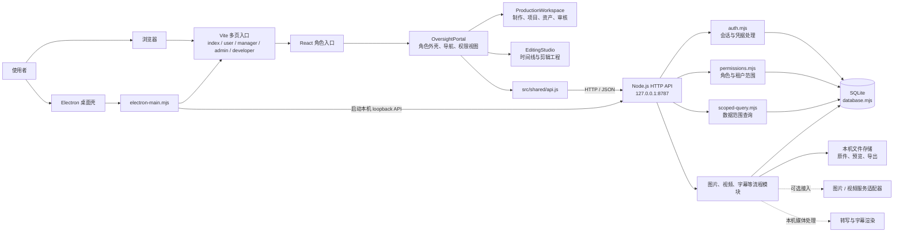

# 系统架构

本文档描述当前仓库代码的主要运行路径。它是实现结构图，不代表所有外部服务都已配置或可用。

## 总体结构

## 请求与数据边界

1. `index.html` 是统一入口：公网环境使用账号登录/邀请注册；本机 loopback 预览和桌面壳通过受限的本地入口进入开发者工作台。
2. `user.html`、`manager.html`、`admin.html`、`developer.html` 分别挂载各自的 React 角色入口。它们共享 `OversightPortal` 外壳和生产工作区组件，但角色权限由服务端再次校验。
3. `src/shared/api.js` 负责携带会话访问 API。默认 API 地址为本机 `127.0.0.1:8787`，部署时可由 `VITE_HJSC_API_BASE` 配置。
4. `server/index.mjs` 负责 HTTP 路由；`auth.mjs` 处理密码哈希和会话令牌；`permissions.mjs` 与 `scoped-query.mjs` 根据已认证账号限制组织和角色可见范围。客户端提交的角色或组织编号不能代替服务端授权。
5. `database.mjs` 管理 SQLite schema；`files.mjs` 与生成存储模块管理本机文件。开发模式数据默认位于 `.hjsc-data/`，Electron 数据位于应用数据目录。
6. 图片/视频服务属于可选后端适配器；密钥应由后端运行环境提供，不应写入前端或提交到仓库。字幕转写和渲染由本机媒体处理模块执行，运行所需的模型或媒体工具需另外配置。
7. 原始 Skill、客户字体和 Premiere 样式属于可选外部素材，出于授权边界未包含在公开作品集副本中。私有部署可在确认授权后放入 `server/skill-sources/`、`public/skill-files/` 或通过页面上传；不提供这些文件时，应用仍可启动，但规范模板没有附带其原文内容。

## 主要模块

| 区域 | 入口或模块 | 职责 |
| --- | --- | --- |
| 前端角色入口 | `src/*-app/main.jsx` | 挂载四种角色应用 |
| 共享工作台 | `src/shared/OversightPortal.jsx` | 角色导航、管理视图、权限范围呈现 |
| 制作工作区 | `src/shared/ProductionWorkspace.jsx` | 项目、规范、资产、生成任务、审核与交付 |
| 剪辑工作台 | `src/shared/EditingStudio.jsx` | 媒体、时间线、音效和剪辑工程交互 |
| API 路由 | `server/index.mjs` | 登录、权限、项目、资产和工作流 HTTP 接口 |
| 数据与权限 | `server/database.mjs`、`server/auth.mjs`、`server/permissions.mjs`、`server/scoped-query.mjs` | SQLite、会话及服务端数据隔离 |
| 文件与媒体 | `server/files.mjs`、`server/transcription.mjs` | 文件存储、转写和字幕渲染 |
| 外部生成 | `server/generation/`、`server/image-workflow.mjs` | 图片/视频服务适配和任务流程 |
| 桌面壳 | `electron-main.mjs`、`electron-preload.cjs` | 启动 loopback API、加载界面和受控桌面能力 |

## 可选本地素材

`server/skill-defaults.mjs` 从 `server/skill-sources/` 读取已获授权的规范源文件；公开仓库不预置该素材库。Premiere 样式和字体可以通过工作区上传控件提供，桌面/烧录环境还需自行安装或配置对应字体。
